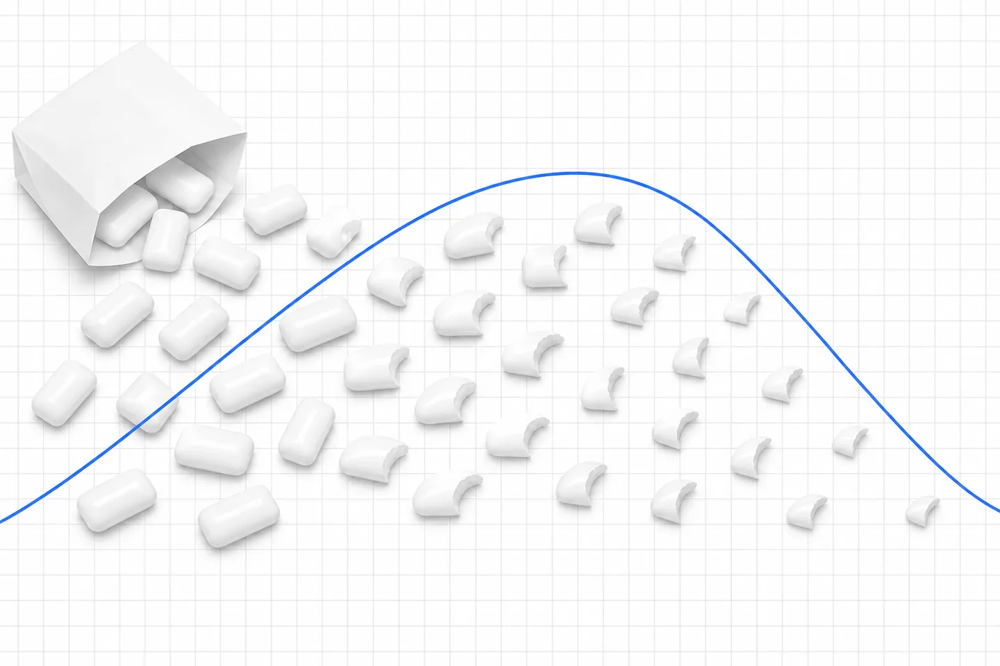

This one came up on vacation this week. A buddy of mine has a math PhD, and his brother, who I'll call Joe, keeps a bag of Chiclets in his car and only ever chews half a piece at a time. He reaches in without looking, bites a whole one in two, and drops the other half back in. Joe turned that habit into a question for his brother: how many grabs until the bag holds exactly as many wholes as halves? My buddy worked it out, then told me the story.

Alright, so my math buddy, being the absolute monster he is, went online, found a TI-84 emulator, programmed the problem into it, and got the answer. Then he kept going with an LLM and found that a differential equation describes it too.

I walked away inspired. I don't have a math PhD, but I do have tools. This post is me working the problem with those tools, to understand it better instead of just knowing the answer.



## The Setup

Joe keeps a bag of Chiclets in his car. When we start, the bag holds `n` whole pieces and nothing else, with `n = 100` in our case. Joe only ever chews half a piece at a time. Whenever he wants gum, he reaches into the bag without looking and pulls out one item. He can't tell a whole piece from a half by feel, so every item in the bag is equally likely to be the one he grabs. If he pulls out a whole piece, he bites it in two, chews one half, and drops the other half back in. If he pulls out a half, he chews it.

We can describe the bag at any moment by two numbers: `w`, the count of whole pieces, and `h`, the count of halves. The bag starts at `(n, 0)`. On any draw, Joe picks a whole with probability `w / (w + h)` and a half with probability `h / (w + h)`. Picking a whole moves the bag to `(w - 1, h + 1)`, and picking a half moves it to `(w, h - 1)`. His first draw is always a whole, since no halves exist yet. Each whole piece takes exactly two draws to finish, one to split it and one to chew the leftover half, so the bag is empty after exactly `2n` draws however the luck falls. The number of wholes never goes up, the number of halves rises or falls by one with each draw, and the bag always ends at `(0, 0)`.

## The Question

At some point the bag might hold exactly as many wholes as halves. That's the 50/50 moment, when Joe's next grab is a coin flip. The question is how many draws it takes to get there for the first time.

The fastest it can happen: Joe pulls a whole 50 times in a row, and on draw 50 the bag sits at `(50, 50)`. The slowest: the bag dodges every balance until it's down to `(1, 1)`, on draw 197. Every bag that balances lands somewhere in that window. Some bags never balance at all. A whole draw shrinks the gap between wholes and halves by two, so the gap can jump from 1 straight to -1 and skip zero. A bag that skips can still climb back later, one chewed half at a time, but some run out of wholes first.

So the answer comes as a distribution. Run a lot of bags, record the draw where each one first balances, and plot it. The tallest bar is our answer.

## Brute Force First

Before borrowing any of my buddy's tricks, here's my instinct: brute force the thing. Simulate Joe emptying a bag, note the draw where it first balances, do that for 1,000 bags, and look at the pile.

```python
import random
from collections import Counter

N = 100      # whole pieces to start
RUNS = 1_000

random.seed(27)


def first_balance(n: int) -> int | None:
    """Draws until wholes == halves, or None."""
    whole, half = n, 0
    for draw in range(1, 2 * n + 1):
        if random.randrange(whole + half) < whole:
            whole, half = whole - 1, half + 1
        else:
            half -= 1
        if whole == half > 0:
            return draw
    return None


results = [first_balance(N) for _ in range(RUNS)]
hits = [r for r in results if r is not None]
top, _ = Counter(hits).most_common(1)[0]

print(f"balanced: {len(hits)} of {RUNS} bags")
print(f"most common draw: {top}")
print(f"average draw: {sum(hits) / len(hits):.1f}")
```

Each call to `first_balance` is one bag. The `randrange` line is Joe's blind grab: pick a random item, and if it lands among the wholes, he got a whole. After every draw, check whether wholes equal halves with something still in the bag. The seed is fixed, so rerunning it gives the same numbers.

```text
$ python3 chiclets.py
balanced: 928 of 1000 bags
most common draw: 83
average draw: 92.7
```

<div><svg viewBox="0 0 640 300" role="img" aria-label="Histogram of 1000 simulated bags. The most common first balance is draw 83; 72 bags never balance." style="width:100%;height:auto;display:block;font-family:var(--mono)"><line x1="44" x2="612" y1="246.0" y2="246.0" stroke="#ececef" stroke-width="1"/><text x="38.0" y="251.0" text-anchor="end" fill="#6b7280" font-size="15" font-weight="400">0%</text><line x1="44" x2="612" y1="203.6" y2="203.6" stroke="#ececef" stroke-width="1"/><text x="38.0" y="208.6" text-anchor="end" fill="#6b7280" font-size="15" font-weight="400">2%</text><line x1="44" x2="612" y1="161.2" y2="161.2" stroke="#ececef" stroke-width="1"/><text x="38.0" y="166.2" text-anchor="end" fill="#6b7280" font-size="15" font-weight="400">4%</text><line x1="44" x2="612" y1="118.8" y2="118.8" stroke="#ececef" stroke-width="1"/><text x="38.0" y="123.8" text-anchor="end" fill="#6b7280" font-size="15" font-weight="400">6%</text><line x1="44" x2="612" y1="76.4" y2="76.4" stroke="#ececef" stroke-width="1"/><text x="38.0" y="81.4" text-anchor="end" fill="#6b7280" font-size="15" font-weight="400">8%</text><line x1="44" x2="612" y1="34.0" y2="34.0" stroke="#ececef" stroke-width="1"/><text x="38.0" y="39.0" text-anchor="end" fill="#6b7280" font-size="15" font-weight="400">10%</text><text x="49.3" y="267.0" text-anchor="middle" fill="#6b7280" font-size="15" font-weight="400">50</text><path d="M76.6,246.0V243.9Q76.6,241.8 78.7,241.8H83.0Q85.1,241.8 85.1,243.9V246.0Z" fill="#a9c1f5"><title>draw 59: 2 bags (0.2%)</title></path><path d="M87.1,246.0V240.5Q87.1,237.5 90.1,237.5H92.6Q95.6,237.5 95.6,240.5V246.0Z" fill="#a9c1f5"><title>draw 62: 4 bags (0.4%)</title></path><path d="M97.6,246.0V227.8Q97.6,224.8 100.6,224.8H103.1Q106.1,224.8 106.1,227.8V246.0Z" fill="#a9c1f5"><title>draw 65: 10 bags (1.0%)</title></path><path d="M108.1,246.0V174.8Q108.1,171.8 111.1,171.8H113.6Q116.6,171.8 116.6,174.8V246.0Z" fill="#a9c1f5"><title>draw 68: 35 bags (3.5%)</title></path><path d="M118.6,246.0V162.1Q118.6,159.1 121.6,159.1H124.1Q127.1,159.1 127.1,162.1V246.0Z" fill="#a9c1f5"><title>draw 71: 41 bags (4.1%)</title></path><path d="M129.1,246.0V128.2Q129.1,125.2 132.1,125.2H134.7Q137.7,125.2 137.7,128.2V246.0Z" fill="#a9c1f5"><title>draw 74: 57 bags (5.7%)</title></path><path d="M139.7,246.0V117.6Q139.7,114.6 142.7,114.6H145.2Q148.2,114.6 148.2,117.6V246.0Z" fill="#a9c1f5"><title>draw 77: 62 bags (6.2%)</title></path><path d="M150.2,246.0V68.8Q150.2,65.8 153.2,65.8H155.7Q158.7,65.8 158.7,68.8V246.0Z" fill="#a9c1f5"><title>draw 80: 85 bags (8.5%)</title></path><text x="154.4" y="267.0" text-anchor="middle" fill="#6b7280" font-size="15" font-weight="400">80</text><path d="M160.7,246.0V56.1Q160.7,53.1 163.7,53.1H166.2Q169.2,53.1 169.2,56.1V246.0Z" fill="#2563eb"><title>draw 83: 91 bags (9.1%)</title></path><text x="165.0" y="45.1" text-anchor="middle" fill="#1c1c1e" font-size="15" font-weight="600">draw 83 · 9.1%</text><path d="M171.2,246.0V60.3Q171.2,57.3 174.2,57.3H176.7Q179.7,57.3 179.7,60.3V246.0Z" fill="#a9c1f5"><title>draw 86: 89 bags (8.9%)</title></path><path d="M181.7,246.0V90.0Q181.7,87.0 184.7,87.0H187.3Q190.3,87.0 190.3,90.0V246.0Z" fill="#a9c1f5"><title>draw 89: 75 bags (7.5%)</title></path><path d="M192.3,246.0V102.7Q192.3,99.7 195.3,99.7H197.8Q200.8,99.7 200.8,102.7V246.0Z" fill="#a9c1f5"><title>draw 92: 69 bags (6.9%)</title></path><path d="M202.8,246.0V126.0Q202.8,123.0 205.8,123.0H208.3Q211.3,123.0 211.3,126.0V246.0Z" fill="#a9c1f5"><title>draw 95: 58 bags (5.8%)</title></path><path d="M213.3,246.0V132.4Q213.3,129.4 216.3,129.4H218.8Q221.8,129.4 221.8,132.4V246.0Z" fill="#a9c1f5"><title>draw 98: 55 bags (5.5%)</title></path><path d="M223.8,246.0V179.0Q223.8,176.0 226.8,176.0H229.3Q232.3,176.0 232.3,179.0V246.0Z" fill="#a9c1f5"><title>draw 101: 33 bags (3.3%)</title></path><path d="M234.3,246.0V193.9Q234.3,190.9 237.3,190.9H239.9Q242.9,190.9 242.9,193.9V246.0Z" fill="#a9c1f5"><title>draw 104: 26 bags (2.6%)</title></path><path d="M244.9,246.0V208.7Q244.9,205.7 247.9,205.7H250.4Q253.4,205.7 253.4,208.7V246.0Z" fill="#a9c1f5"><title>draw 107: 19 bags (1.9%)</title></path><path d="M255.4,246.0V206.6Q255.4,203.6 258.4,203.6H260.9Q263.9,203.6 263.9,206.6V246.0Z" fill="#a9c1f5"><title>draw 110: 20 bags (2.0%)</title></path><text x="259.6" y="267.0" text-anchor="middle" fill="#6b7280" font-size="15" font-weight="400">110</text><path d="M265.9,246.0V210.8Q265.9,207.8 268.9,207.8H271.4Q274.4,207.8 274.4,210.8V246.0Z" fill="#a9c1f5"><title>draw 113: 18 bags (1.8%)</title></path><path d="M276.4,246.0V219.3Q276.4,216.3 279.4,216.3H281.9Q284.9,216.3 284.9,219.3V246.0Z" fill="#a9c1f5"><title>draw 116: 14 bags (1.4%)</title></path><path d="M286.9,246.0V232.0Q286.9,229.0 289.9,229.0H292.4Q295.4,229.0 295.4,232.0V246.0Z" fill="#a9c1f5"><title>draw 119: 8 bags (0.8%)</title></path><path d="M297.4,246.0V238.4Q297.4,235.4 300.4,235.4H303.0Q306.0,235.4 306.0,238.4V246.0Z" fill="#a9c1f5"><title>draw 122: 5 bags (0.5%)</title></path><path d="M308.0,246.0V238.4Q308.0,235.4 311.0,235.4H313.5Q316.5,235.4 316.5,238.4V246.0Z" fill="#a9c1f5"><title>draw 125: 5 bags (0.5%)</title></path><path d="M318.5,246.0V243.9Q318.5,241.8 320.6,241.8H324.9Q327.0,241.8 327.0,243.9V246.0Z" fill="#a9c1f5"><title>draw 128: 2 bags (0.2%)</title></path><path d="M329.0,246.0V243.9Q329.0,241.8 331.1,241.8H335.4Q337.5,241.8 337.5,243.9V246.0Z" fill="#a9c1f5"><title>draw 131: 2 bags (0.2%)</title></path><path d="M350.0,246.0V244.9Q350.0,243.9 351.1,243.9H357.5Q358.6,243.9 358.6,244.9V246.0Z" fill="#a9c1f5"><title>draw 137: 1 bag (0.1%)</title></path><text x="364.8" y="267.0" text-anchor="middle" fill="#6b7280" font-size="15" font-weight="400">140</text><path d="M423.7,246.0V244.9Q423.7,243.9 424.7,243.9H431.1Q432.2,243.9 432.2,244.9V246.0Z" fill="#a9c1f5"><title>draw 158: 1 bag (0.1%)</title></path><path d="M465.7,246.0V244.9Q465.7,243.9 466.8,243.9H473.2Q474.3,243.9 474.3,244.9V246.0Z" fill="#a9c1f5"><title>draw 170: 1 bag (0.1%)</title></path><text x="470.0" y="267.0" text-anchor="middle" fill="#6b7280" font-size="15" font-weight="400">170</text><path d="M486.8,246.0V242.6Q486.8,239.6 489.8,239.6H492.3Q495.3,239.6 495.3,242.6V246.0Z" fill="#a9c1f5"><title>draw 176: 3 bags (0.3%)</title></path><path d="M497.3,246.0V244.9Q497.3,243.9 498.4,243.9H504.8Q505.8,243.9 505.8,244.9V246.0Z" fill="#a9c1f5"><title>draw 179: 1 bag (0.1%)</title></path><path d="M507.8,246.0V243.9Q507.8,241.8 509.9,241.8H514.2Q516.3,241.8 516.3,243.9V246.0Z" fill="#a9c1f5"><title>draw 182: 2 bags (0.2%)</title></path><path d="M518.3,246.0V244.9Q518.3,243.9 519.4,243.9H525.8Q526.9,243.9 526.9,244.9V246.0Z" fill="#a9c1f5"><title>draw 185: 1 bag (0.1%)</title></path><path d="M528.9,246.0V242.6Q528.9,239.6 531.9,239.6H534.4Q537.4,239.6 537.4,242.6V246.0Z" fill="#a9c1f5"><title>draw 188: 3 bags (0.3%)</title></path><path d="M539.4,246.0V242.6Q539.4,239.6 542.4,239.6H544.9Q547.9,239.6 547.9,242.6V246.0Z" fill="#a9c1f5"><title>draw 191: 3 bags (0.3%)</title></path><path d="M549.9,246.0V227.8Q549.9,224.8 552.9,224.8H555.4Q558.4,224.8 558.4,227.8V246.0Z" fill="#a9c1f5"><title>draw 194: 10 bags (1.0%)</title></path><path d="M560.4,246.0V213.0Q560.4,210.0 563.4,210.0H565.9Q568.9,210.0 568.9,213.0V246.0Z" fill="#a9c1f5"><title>draw 197: 17 bags (1.7%)</title></path><text x="564.7" y="267.0" text-anchor="middle" fill="#6b7280" font-size="15" font-weight="400">197</text><path d="M602.5,246.0V96.4Q602.5,93.4 605.5,93.4H608.0Q611.0,93.4 611.0,96.4V246.0Z" fill="#c4c8cf"><title>never balanced: 72 bags (7.2%)</title></path><text x="606.7" y="267.0" text-anchor="middle" fill="#6b7280" font-size="15" font-weight="400">never</text><text x="328.0" y="294.0" text-anchor="middle" fill="#6b7280" font-size="15" font-weight="400">draw on which the bag first balances</text></svg></div>

Draw 83 wins, edging out 86 by two bags and 80 by six. The pile climbs fast off the 50-draw floor, peaks in the low 80s, and trails off through the 100s. The average, 92.7, gets dragged right by that tail and by a little cluster of late bloomers at 191 to 197, bags that dodged balance almost to the end. Another 72 bags never balanced at all.

The bars only sit on every third draw, and that's just bookkeeping. Getting to `(k, k)` takes `n - k` wholes split plus `n - 2k` halves chewed, which is `2n - 3k` draws. Each step down in `k` adds three.

## Brute Force: Pros and Cons

This is the programmer move. It works, and it's also kind of meathead.

The good part is how little it asks of you. It's about twenty lines, and the only math in it is "pick a random item." The code follows the story line for line, so if the story is right, the simulation is right, and that makes it hard to screw up. It also shows you the shape of the thing. I wouldn't have guessed the lopsided pile, the late cluster near draw 197, or the bags that never balance at all. And whatever the math says later has to agree with this chart, so the simulation doubles as a referee.

The bad part is everything it can't tell you. It's noisy: with 1,000 bags, draws 80, 83, and 86 sit within a few bags of each other, and a different seed could crown a different bar. It answers one `n` at a time, so the result for 100 pieces says nothing about 1,000 without rerunning. It tells you where the peak is but not why it's there. And at the end you're holding a pile of samples, not a formula or a proof.

Brute force answers what happens. The rest of this post is about why.

## Following the Drift

Brute force told us what happens. My math buddy's second move, the differential equation, gets at why.

Any one bag is random. Averaged over lots of bags, though, the bag drifts in a predictable direction. On a given grab, Joe pulls a whole with probability `w / (w + h)`. When that happens, wholes drop by one and halves rise by one. Otherwise he pulls a half, and halves drop by one. Put those together and on an average grab the wholes go down by `w / (w + h)` and the halves change by `(w - h) / (w + h)`.

We don't care how many grabs have gone by, though. We care how the halves move as the wholes get used up. So divide one change by the other. The messy `w + h` cancels and leaves something clean: for every whole that gets used up, the halves go up by `1 - h / w`. At the start there are no halves, so each whole used up adds a full half. By the time halves match wholes, it adds nothing.

Here's the leap. Wholes and halves come in whole numbers, but in a 100-piece bag it does little harm to pretend they're smooth quantities that slide continuously. Make that leap and the rule becomes a differential equation. One wrinkle: math writes slopes in the direction of more wholes, not fewer, so the sign flips:

```text
dh/dw = h/w - 1
```

A differential equation is a rule for how one thing changes as another changes. Read `dh/dw` as "how much the halves change per extra whole." It's the same rule as before, measured in the other direction. Solving it means finding the curve that obeys that rule at every point, starting from where the bag starts, with `n` wholes and no halves.

### Enter SymPy

You could solve this with pencil and paper. A computer can too, and the tool for it in Python is SymPy.

Most code works with numbers. Ask Python for the square root of 2 and you get `1.4142135623730951`, an approximation. SymPy works with symbols instead. Ask it for the square root of 2 and you get `sqrt(2)`, exactly. It can push symbols like `w` and `n` through algebra and calculus the way you would on paper: expanding, simplifying, taking derivatives, solving equations. It's free, open source, and written entirely in Python, so `pip install sympy` is all it takes. If you've ever used Mathematica, or the algebra mode on a fancier calculator like a TI-89 (the TI-84's bigger sibling), it's that idea.

Here's the whole thing:

```python
import sympy as sp

# Symbols, not numbers. w: wholes left, n: start
w, n = sp.symbols("w n", positive=True)
h = sp.Function("h")  # halves, as a function of wholes

# The drift rule: dh/dw = h/w - 1
rule = sp.Eq(h(w).diff(w), h(w) / w - 1)

# Solve it, starting from n wholes and zero halves
path = sp.dsolve(rule, h(w), ics={h(n): 0}).rhs
print("path:   h =", path)

# Where does the path cross wholes == halves?
(balance,) = sp.solve(sp.Eq(path, w), w)
print("even at w =", balance)

# Draws to get there: 2n - 3w, from the bookkeeping
draws = sp.collect(2 * n - 3 * balance, n)
print("draws:  ", draws)
print("n = 100:", draws.subs(n, 100).evalf(3))
```

Line by line: `symbols` creates `w` and `n` as symbols rather than numbers, and `positive=True` tells SymPy they're above zero, so it can take logs without worrying. `Function("h")` declares `h` as an unknown function of `w`, which is what we're solving for. `Eq(...)` writes down the drift rule: the derivative of `h` with respect to `w` equals `h/w - 1`. Then `dsolve`, SymPy's differential equation solver, does the calculus, and `ics={h(n): 0}` pins the starting point at `n` wholes and zero halves. After that, `solve` finds where the path crosses wholes equal halves, and the last step plugs that into the `2n - 3k` bookkeeping from earlier to turn it into a draw count.

```text
$ python3 drift.py
path:   h = w*(log(n) - log(w))
even at w = n*exp(-1)
draws:   n*(2 - 3*exp(-1))
n = 100: 89.6
```

Translated out of SymPy: the first line is the bag's smooth path, `h = w ln(n/w)`. SymPy's `log` is the natural log, and `log(n) - log(w)` is the same as `ln(n/w)`. The second line says the halves catch up to the wholes when `w = n/e`, where `e` is the famous 2.718. That's when about 37% of the wholes are left, or 36.8 pieces in our bag. The third line turns that into draws, `n(2 - 3/e)`, a little under 0.9 draws per starting piece. For 100 pieces, 89.6.

There's a nice bonus hiding in the rule. The slope `h/w - 1` is zero exactly when `h = w`, which means the pile of halves is at its biggest at the moment of balance. That makes sense once you see it. While halves are scarce, most grabs split wholes and the half pile grows. Once halves outnumber wholes, most grabs chew halves and the pile shrinks. The tipping point is the balance point.

Here's the smooth path drawn against 20 simulated bags:

<div><svg viewBox="0 0 640 360" role="img" aria-label="20 simulated bags drawn as paths from 100 wholes down to zero, with the smooth path h = w ln(n/w) running through them. The smooth path meets the wholes-equal-halves line at w = n/e." style="width:100%;height:auto;display:block;font-family:var(--mono)"><line x1="48" x2="620" y1="306.0" y2="306.0" stroke="#ececef" stroke-width="1"/><text x="40.0" y="311.0" text-anchor="end" fill="#6b7280" font-size="15" font-weight="400">0</text><line x1="48" x2="620" y1="253.6" y2="253.6" stroke="#ececef" stroke-width="1"/><text x="40.0" y="258.6" text-anchor="end" fill="#6b7280" font-size="15" font-weight="400">10</text><line x1="48" x2="620" y1="201.2" y2="201.2" stroke="#ececef" stroke-width="1"/><text x="40.0" y="206.2" text-anchor="end" fill="#6b7280" font-size="15" font-weight="400">20</text><line x1="48" x2="620" y1="148.8" y2="148.8" stroke="#ececef" stroke-width="1"/><text x="40.0" y="153.8" text-anchor="end" fill="#6b7280" font-size="15" font-weight="400">30</text><line x1="48" x2="620" y1="96.4" y2="96.4" stroke="#ececef" stroke-width="1"/><text x="40.0" y="101.4" text-anchor="end" fill="#6b7280" font-size="15" font-weight="400">40</text><line x1="48" x2="620" y1="44.0" y2="44.0" stroke="#ececef" stroke-width="1"/><text x="40.0" y="49.0" text-anchor="end" fill="#6b7280" font-size="15" font-weight="400">50</text><text x="48.0" y="328.0" text-anchor="middle" fill="#6b7280" font-size="15" font-weight="400">100</text><text x="162.4" y="328.0" text-anchor="middle" fill="#6b7280" font-size="15" font-weight="400">80</text><text x="276.8" y="328.0" text-anchor="middle" fill="#6b7280" font-size="15" font-weight="400">60</text><text x="391.2" y="328.0" text-anchor="middle" fill="#6b7280" font-size="15" font-weight="400">40</text><text x="505.6" y="328.0" text-anchor="middle" fill="#6b7280" font-size="15" font-weight="400">20</text><text x="620.0" y="328.0" text-anchor="middle" fill="#6b7280" font-size="15" font-weight="400">0</text><polyline points="334.0,44.0 620.0,306.0" fill="none" stroke="#8b919c" stroke-width="1.5" stroke-linejoin="round" stroke-linecap="round" /><polyline points="48.0,306.0 156.7,206.4 156.7,216.9 162.4,211.7 162.4,216.9 185.3,196.0 185.3,201.2 191.0,196.0 191.0,201.2 208.2,185.5 208.2,190.7 225.3,175.0 225.3,180.2 231.0,175.0 231.0,185.5 236.8,180.2 236.8,190.7 265.4,164.5 265.4,175.0 294.0,148.8 294.0,154.0 305.4,143.6 305.4,148.8 311.1,143.6 311.1,148.8 322.6,138.3 322.6,154.0 334.0,143.6 334.0,154.0 368.3,122.6 368.3,138.3 374.0,133.1 374.0,138.3 391.2,122.6 391.2,133.1 396.9,127.8 396.9,138.3 402.6,133.1 402.6,143.6 408.4,138.3 408.4,143.6 419.8,133.1 419.8,154.0 431.2,143.6 431.2,148.8 437.0,143.6 437.0,154.0 442.7,148.8 442.7,169.8 454.1,159.3 454.1,164.5 465.6,154.0 465.6,159.3 477.0,148.8 477.0,159.3 488.4,148.8 488.4,180.2 499.9,169.8 499.9,175.0 505.6,169.8 505.6,175.0 517.0,164.5 517.0,169.8 522.8,164.5 522.8,175.0 528.5,169.8 528.5,175.0 551.4,154.0 551.4,164.5 557.1,159.3 557.1,169.8 562.8,164.5 562.8,180.2 568.5,175.0 568.5,201.2 574.2,196.0 574.2,222.2 580.0,216.9 580.0,222.2 585.7,216.9 585.7,232.6 591.4,227.4 591.4,232.6 597.1,227.4 597.1,232.6 602.8,227.4 602.8,248.4 608.6,243.1 608.6,248.4 614.3,243.1 614.3,269.3 620.0,264.1 620.0,306.0" fill="none" stroke="#d9dbe0" stroke-width="1" stroke-linejoin="round" stroke-linecap="round" opacity="0.8"/><polyline points="48.0,306.0 88.0,269.3 88.0,274.6 128.1,237.9 128.1,243.1 168.1,206.4 168.1,211.7 202.4,180.2 202.4,185.5 208.2,180.2 208.2,190.7 213.9,185.5 213.9,196.0 225.3,185.5 225.3,190.7 231.0,185.5 231.0,190.7 248.2,175.0 248.2,180.2 259.6,169.8 259.6,180.2 271.1,169.8 271.1,180.2 282.5,169.8 282.5,175.0 288.2,169.8 288.2,175.0 299.7,164.5 299.7,169.8 305.4,164.5 305.4,169.8 311.1,164.5 311.1,169.8 316.8,164.5 316.8,180.2 356.9,143.6 356.9,154.0 362.6,148.8 362.6,154.0 385.5,133.1 385.5,148.8 396.9,138.3 396.9,143.6 431.2,112.1 431.2,133.1 448.4,117.4 448.4,122.6 459.8,112.1 459.8,133.1 471.3,122.6 471.3,133.1 477.0,127.8 477.0,133.1 488.4,122.6 488.4,133.1 494.2,127.8 494.2,133.1 499.9,127.8 499.9,133.1 505.6,127.8 505.6,138.3 511.3,133.1 511.3,138.3 517.0,133.1 517.0,148.8 534.2,133.1 534.2,138.3 551.4,122.6 551.4,143.6 557.1,138.3 557.1,148.8 562.8,143.6 562.8,148.8 568.5,143.6 568.5,206.4 580.0,196.0 580.0,253.6 597.1,237.9 597.1,253.6 602.8,248.4 602.8,258.8 608.6,253.6 608.6,285.0 614.3,279.8 614.3,290.3 620.0,285.0 620.0,306.0" fill="none" stroke="#d9dbe0" stroke-width="1" stroke-linejoin="round" stroke-linecap="round" opacity="0.8"/><polyline points="48.0,306.0 110.9,248.4 110.9,253.6 156.7,211.7 156.7,216.9 213.9,164.5 213.9,169.8 225.3,159.3 225.3,175.0 248.2,154.0 248.2,159.3 271.1,138.3 271.1,154.0 276.8,148.8 276.8,154.0 282.5,148.8 282.5,159.3 294.0,148.8 294.0,154.0 305.4,143.6 305.4,154.0 316.8,143.6 316.8,164.5 328.3,154.0 328.3,159.3 345.4,143.6 345.4,148.8 362.6,133.1 362.6,148.8 368.3,143.6 368.3,159.3 391.2,138.3 391.2,143.6 414.1,122.6 414.1,148.8 419.8,143.6 419.8,148.8 425.5,143.6 425.5,148.8 431.2,143.6 431.2,154.0 442.7,143.6 442.7,180.2 448.4,175.0 448.4,185.5 454.1,180.2 454.1,211.7 459.8,206.4 459.8,211.7 465.6,206.4 465.6,211.7 488.4,190.7 488.4,243.1 494.2,237.9 494.2,243.1 499.9,237.9 499.9,243.1 505.6,237.9 505.6,243.1 517.0,232.6 517.0,237.9 528.5,227.4 528.5,232.6 534.2,227.4 534.2,237.9 539.9,232.6 539.9,253.6 545.6,248.4 545.6,258.8 557.1,248.4 557.1,253.6 562.8,248.4 562.8,253.6 574.2,243.1 574.2,248.4 585.7,237.9 585.7,243.1 591.4,237.9 591.4,243.1 597.1,237.9 597.1,253.6 608.6,243.1 608.6,253.6 614.3,248.4 614.3,258.8 620.0,253.6 620.0,306.0" fill="none" stroke="#d9dbe0" stroke-width="1" stroke-linejoin="round" stroke-linecap="round" opacity="0.8"/><polyline points="48.0,306.0 76.6,279.8 76.6,285.0 110.9,253.6 110.9,258.8 151.0,222.2 151.0,227.4 213.9,169.8 213.9,196.0 231.0,180.2 231.0,185.5 242.5,175.0 242.5,201.2 305.4,143.6 305.4,148.8 311.1,143.6 311.1,148.8 322.6,138.3 322.6,143.6 356.9,112.1 356.9,117.4 396.9,80.7 396.9,85.9 402.6,80.7 402.6,91.2 408.4,85.9 408.4,106.9 414.1,101.6 414.1,112.1 419.8,106.9 419.8,112.1 431.2,101.6 431.2,112.1 454.1,91.2 454.1,96.4 465.6,85.9 465.6,96.4 471.3,91.2 471.3,101.6 477.0,96.4 477.0,122.6 482.7,117.4 482.7,143.6 494.2,133.1 494.2,138.3 499.9,133.1 499.9,143.6 505.6,138.3 505.6,154.0 511.3,148.8 511.3,159.3 517.0,154.0 517.0,159.3 522.8,154.0 522.8,159.3 528.5,154.0 528.5,159.3 534.2,154.0 534.2,175.0 539.9,169.8 539.9,185.5 562.8,164.5 562.8,175.0 568.5,169.8 568.5,201.2 574.2,196.0 574.2,216.9 580.0,211.7 580.0,237.9 585.7,232.6 585.7,248.4 591.4,243.1 591.4,253.6 597.1,248.4 597.1,264.1 602.8,258.8 602.8,264.1 608.6,258.8 608.6,279.8 620.0,269.3 620.0,306.0" fill="none" stroke="#d9dbe0" stroke-width="1" stroke-linejoin="round" stroke-linecap="round" opacity="0.8"/><polyline points="48.0,306.0 122.4,237.9 122.4,243.1 173.8,196.0 173.8,201.2 196.7,180.2 196.7,190.7 208.2,180.2 208.2,185.5 219.6,175.0 219.6,180.2 231.0,169.8 231.0,180.2 236.8,175.0 236.8,180.2 242.5,175.0 242.5,185.5 248.2,180.2 248.2,185.5 253.9,180.2 253.9,185.5 259.6,180.2 259.6,185.5 271.1,175.0 271.1,180.2 299.7,154.0 299.7,159.3 311.1,148.8 311.1,159.3 322.6,148.8 322.6,175.0 328.3,169.8 328.3,175.0 334.0,169.8 334.0,175.0 368.3,143.6 368.3,154.0 379.8,143.6 379.8,154.0 385.5,148.8 385.5,164.5 391.2,159.3 391.2,164.5 402.6,154.0 402.6,164.5 408.4,159.3 408.4,169.8 419.8,159.3 419.8,164.5 465.6,122.6 465.6,127.8 477.0,117.4 477.0,148.8 494.2,133.1 494.2,143.6 499.9,138.3 499.9,154.0 505.6,148.8 505.6,154.0 511.3,148.8 511.3,154.0 517.0,148.8 517.0,154.0 539.9,133.1 539.9,154.0 545.6,148.8 545.6,159.3 551.4,154.0 551.4,159.3 562.8,148.8 562.8,190.7 568.5,185.5 568.5,190.7 574.2,185.5 574.2,196.0 580.0,190.7 580.0,232.6 585.7,227.4 585.7,237.9 591.4,232.6 591.4,279.8 608.6,264.1 608.6,285.0 614.3,279.8 614.3,285.0 620.0,279.8 620.0,306.0" fill="none" stroke="#d9dbe0" stroke-width="1" stroke-linejoin="round" stroke-linecap="round" opacity="0.8"/><polyline points="48.0,306.0 105.2,253.6 105.2,264.1 116.6,253.6 116.6,258.8 133.8,243.1 133.8,248.4 156.7,227.4 156.7,237.9 185.3,211.7 185.3,216.9 202.4,201.2 202.4,211.7 225.3,190.7 225.3,196.0 231.0,190.7 231.0,196.0 236.8,190.7 236.8,196.0 248.2,185.5 248.2,196.0 271.1,175.0 271.1,180.2 294.0,159.3 294.0,164.5 305.4,154.0 305.4,169.8 311.1,164.5 311.1,175.0 316.8,169.8 316.8,175.0 328.3,164.5 328.3,169.8 334.0,164.5 334.0,180.2 345.4,169.8 345.4,180.2 351.2,175.0 351.2,180.2 362.6,169.8 362.6,180.2 374.0,169.8 374.0,175.0 379.8,169.8 379.8,175.0 385.5,169.8 385.5,175.0 396.9,164.5 396.9,169.8 408.4,159.3 408.4,169.8 414.1,164.5 414.1,175.0 425.5,164.5 425.5,169.8 431.2,164.5 431.2,169.8 448.4,154.0 448.4,164.5 465.6,148.8 465.6,154.0 471.3,148.8 471.3,154.0 482.7,143.6 482.7,148.8 488.4,143.6 488.4,148.8 505.6,133.1 505.6,159.3 511.3,154.0 511.3,159.3 522.8,148.8 522.8,154.0 528.5,148.8 528.5,164.5 534.2,159.3 534.2,169.8 539.9,164.5 539.9,169.8 551.4,159.3 551.4,201.2 557.1,196.0 557.1,201.2 562.8,196.0 562.8,206.4 568.5,201.2 568.5,206.4 574.2,201.2 574.2,206.4 580.0,201.2 580.0,211.7 585.7,206.4 585.7,227.4 591.4,222.2 591.4,232.6 597.1,227.4 597.1,237.9 602.8,232.6 602.8,248.4 614.3,237.9 614.3,243.1 620.0,237.9 620.0,306.0" fill="none" stroke="#d9dbe0" stroke-width="1" stroke-linejoin="round" stroke-linecap="round" opacity="0.8"/><polyline points="48.0,306.0 59.4,295.5 59.4,300.8 156.7,211.7 156.7,216.9 236.8,143.6 236.8,148.8 242.5,143.6 242.5,154.0 294.0,106.9 294.0,112.1 316.8,91.2 316.8,101.6 328.3,91.2 328.3,106.9 334.0,101.6 334.0,122.6 351.2,106.9 351.2,112.1 356.9,106.9 356.9,117.4 362.6,112.1 362.6,117.4 368.3,112.1 368.3,117.4 374.0,112.1 374.0,117.4 379.8,112.1 379.8,117.4 391.2,106.9 391.2,112.1 396.9,106.9 396.9,112.1 414.1,96.4 414.1,101.6 437.0,80.7 437.0,85.9 448.4,75.4 448.4,80.7 454.1,75.4 454.1,80.7 459.8,75.4 459.8,101.6 471.3,91.2 471.3,96.4 488.4,80.7 488.4,85.9 494.2,80.7 494.2,101.6 499.9,96.4 499.9,117.4 505.6,112.1 505.6,127.8 517.0,117.4 517.0,159.3 522.8,154.0 522.8,175.0 528.5,169.8 528.5,180.2 539.9,169.8 539.9,180.2 545.6,175.0 545.6,206.4 551.4,201.2 551.4,206.4 557.1,201.2 557.1,206.4 568.5,196.0 568.5,201.2 580.0,190.7 580.0,196.0 585.7,190.7 585.7,264.1 597.1,253.6 597.1,258.8 602.8,253.6 602.8,274.6 608.6,269.3 608.6,290.3 614.3,285.0 614.3,300.8 620.0,295.5 620.0,306.0" fill="none" stroke="#d9dbe0" stroke-width="1" stroke-linejoin="round" stroke-linecap="round" opacity="0.8"/><polyline points="48.0,306.0 59.4,295.5 59.4,300.8 122.4,243.1 122.4,248.4 133.8,237.9 133.8,243.1 139.5,237.9 139.5,243.1 168.1,216.9 168.1,222.2 236.8,159.3 236.8,175.0 248.2,164.5 248.2,175.0 253.9,169.8 253.9,180.2 259.6,175.0 259.6,180.2 299.7,143.6 299.7,148.8 305.4,143.6 305.4,148.8 311.1,143.6 311.1,159.3 345.4,127.8 345.4,143.6 356.9,133.1 356.9,138.3 362.6,133.1 362.6,138.3 368.3,133.1 368.3,138.3 385.5,122.6 385.5,133.1 396.9,122.6 396.9,127.8 402.6,122.6 402.6,133.1 419.8,117.4 419.8,148.8 431.2,138.3 431.2,154.0 437.0,148.8 437.0,154.0 442.7,148.8 442.7,154.0 448.4,148.8 448.4,164.5 459.8,154.0 459.8,190.7 471.3,180.2 471.3,185.5 482.7,175.0 482.7,180.2 488.4,175.0 488.4,180.2 499.9,169.8 499.9,175.0 505.6,169.8 505.6,175.0 511.3,169.8 511.3,190.7 517.0,185.5 517.0,190.7 522.8,185.5 522.8,227.4 539.9,211.7 539.9,222.2 545.6,216.9 545.6,227.4 557.1,216.9 557.1,222.2 562.8,216.9 562.8,227.4 568.5,222.2 568.5,227.4 574.2,222.2 574.2,227.4 580.0,222.2 580.0,227.4 585.7,222.2 585.7,264.1 591.4,258.8 591.4,264.1 597.1,258.8 597.1,264.1 602.8,258.8 602.8,274.6 608.6,269.3 608.6,279.8 614.3,274.6 614.3,279.8 620.0,274.6 620.0,306.0" fill="none" stroke="#d9dbe0" stroke-width="1" stroke-linejoin="round" stroke-linecap="round" opacity="0.8"/><polyline points="48.0,306.0 110.9,248.4 110.9,253.6 162.4,206.4 162.4,211.7 196.7,180.2 196.7,185.5 225.3,159.3 225.3,164.5 248.2,143.6 248.2,148.8 253.9,143.6 253.9,148.8 288.2,117.4 288.2,122.6 294.0,117.4 294.0,127.8 311.1,112.1 311.1,138.3 334.0,117.4 334.0,133.1 351.2,117.4 351.2,127.8 368.3,112.1 368.3,117.4 374.0,112.1 374.0,117.4 379.8,112.1 379.8,117.4 385.5,112.1 385.5,122.6 391.2,117.4 391.2,127.8 402.6,117.4 402.6,122.6 408.4,117.4 408.4,122.6 414.1,117.4 414.1,127.8 425.5,117.4 425.5,122.6 431.2,117.4 431.2,143.6 454.1,122.6 454.1,133.1 482.7,106.9 482.7,138.3 488.4,133.1 488.4,148.8 499.9,138.3 499.9,148.8 505.6,143.6 505.6,148.8 511.3,143.6 511.3,154.0 517.0,148.8 517.0,154.0 528.5,143.6 528.5,148.8 534.2,143.6 534.2,154.0 539.9,148.8 539.9,154.0 545.6,148.8 545.6,180.2 551.4,175.0 551.4,185.5 562.8,175.0 562.8,211.7 568.5,206.4 568.5,222.2 574.2,216.9 574.2,222.2 580.0,216.9 580.0,243.1 591.4,232.6 591.4,248.4 597.1,243.1 597.1,258.8 608.6,248.4 608.6,274.6 614.3,269.3 614.3,290.3 620.0,285.0 620.0,306.0" fill="none" stroke="#d9dbe0" stroke-width="1" stroke-linejoin="round" stroke-linecap="round" opacity="0.8"/><polyline points="48.0,306.0 76.6,279.8 76.6,285.0 168.1,201.2 168.1,206.4 196.7,180.2 196.7,185.5 202.4,180.2 202.4,185.5 219.6,169.8 219.6,175.0 259.6,138.3 259.6,148.8 265.4,143.6 265.4,148.8 271.1,143.6 271.1,148.8 276.8,143.6 276.8,148.8 299.7,127.8 299.7,138.3 305.4,133.1 305.4,143.6 311.1,138.3 311.1,148.8 316.8,143.6 316.8,148.8 339.7,127.8 339.7,133.1 351.2,122.6 351.2,127.8 362.6,117.4 362.6,122.6 374.0,112.1 374.0,117.4 391.2,101.6 391.2,106.9 396.9,101.6 396.9,127.8 408.4,117.4 408.4,122.6 414.1,117.4 414.1,122.6 431.2,106.9 431.2,122.6 437.0,117.4 437.0,122.6 442.7,117.4 442.7,122.6 448.4,117.4 448.4,127.8 465.6,112.1 465.6,117.4 471.3,112.1 471.3,143.6 477.0,138.3 477.0,143.6 488.4,133.1 488.4,138.3 494.2,133.1 494.2,143.6 505.6,133.1 505.6,143.6 511.3,138.3 511.3,143.6 522.8,133.1 522.8,143.6 539.9,127.8 539.9,164.5 545.6,159.3 545.6,180.2 551.4,175.0 551.4,196.0 562.8,185.5 562.8,237.9 568.5,232.6 568.5,237.9 585.7,222.2 585.7,243.1 591.4,237.9 591.4,243.1 597.1,237.9 597.1,258.8 608.6,248.4 608.6,274.6 620.0,264.1 620.0,306.0" fill="none" stroke="#d9dbe0" stroke-width="1" stroke-linejoin="round" stroke-linecap="round" opacity="0.8"/><polyline points="48.0,306.0 116.6,243.1 116.6,248.4 151.0,216.9 151.0,227.4 168.1,211.7 168.1,216.9 173.8,211.7 173.8,216.9 202.4,190.7 202.4,201.2 219.6,185.5 219.6,190.7 253.9,159.3 253.9,169.8 282.5,143.6 282.5,148.8 294.0,138.3 294.0,143.6 334.0,106.9 334.0,117.4 356.9,96.4 356.9,101.6 362.6,96.4 362.6,117.4 368.3,112.1 368.3,138.3 374.0,133.1 374.0,138.3 408.4,106.9 408.4,127.8 414.1,122.6 414.1,138.3 425.5,127.8 425.5,133.1 431.2,127.8 431.2,133.1 442.7,122.6 442.7,127.8 448.4,122.6 448.4,138.3 465.6,122.6 465.6,127.8 471.3,122.6 471.3,133.1 477.0,127.8 477.0,138.3 482.7,133.1 482.7,148.8 488.4,143.6 488.4,148.8 494.2,143.6 494.2,154.0 511.3,138.3 511.3,154.0 528.5,138.3 528.5,143.6 539.9,133.1 539.9,159.3 545.6,154.0 545.6,159.3 551.4,154.0 551.4,164.5 557.1,159.3 557.1,169.8 562.8,164.5 562.8,175.0 574.2,164.5 574.2,232.6 580.0,227.4 580.0,253.6 597.1,237.9 597.1,248.4 614.3,232.6 614.3,258.8 620.0,253.6 620.0,306.0" fill="none" stroke="#d9dbe0" stroke-width="1" stroke-linejoin="round" stroke-linecap="round" opacity="0.8"/><polyline points="48.0,306.0 93.8,264.1 93.8,274.6 99.5,269.3 99.5,274.6 208.2,175.0 208.2,180.2 242.5,148.8 242.5,154.0 259.6,138.3 259.6,148.8 276.8,133.1 276.8,138.3 316.8,101.6 316.8,106.9 322.6,101.6 322.6,122.6 328.3,117.4 328.3,122.6 334.0,117.4 334.0,122.6 362.6,96.4 362.6,106.9 368.3,101.6 368.3,106.9 374.0,101.6 374.0,112.1 396.9,91.2 396.9,96.4 402.6,91.2 402.6,106.9 408.4,101.6 408.4,106.9 414.1,101.6 414.1,112.1 425.5,101.6 425.5,106.9 442.7,91.2 442.7,106.9 448.4,101.6 448.4,106.9 459.8,96.4 459.8,106.9 471.3,96.4 471.3,101.6 477.0,96.4 477.0,101.6 482.7,96.4 482.7,112.1 488.4,106.9 488.4,112.1 494.2,106.9 494.2,122.6 499.9,117.4 499.9,143.6 505.6,138.3 505.6,148.8 511.3,143.6 511.3,148.8 517.0,143.6 517.0,159.3 522.8,154.0 522.8,159.3 534.2,148.8 534.2,180.2 545.6,169.8 545.6,175.0 551.4,169.8 551.4,196.0 557.1,190.7 557.1,201.2 562.8,196.0 562.8,201.2 568.5,196.0 568.5,201.2 574.2,196.0 574.2,201.2 580.0,196.0 580.0,206.4 585.7,201.2 585.7,206.4 597.1,196.0 597.1,201.2 602.8,196.0 602.8,243.1 608.6,237.9 608.6,243.1 614.3,237.9 614.3,248.4 620.0,243.1 620.0,306.0" fill="none" stroke="#d9dbe0" stroke-width="1" stroke-linejoin="round" stroke-linecap="round" opacity="0.8"/><polyline points="48.0,306.0 99.5,258.8 99.5,264.1 122.4,243.1 122.4,248.4 185.3,190.7 185.3,196.0 196.7,185.5 196.7,201.2 202.4,196.0 202.4,201.2 208.2,196.0 208.2,201.2 225.3,185.5 225.3,190.7 242.5,175.0 242.5,180.2 282.5,143.6 282.5,148.8 288.2,143.6 288.2,154.0 294.0,148.8 294.0,159.3 305.4,148.8 305.4,154.0 311.1,148.8 311.1,154.0 339.7,127.8 339.7,133.1 345.4,127.8 345.4,133.1 362.6,117.4 362.6,122.6 379.8,106.9 379.8,122.6 391.2,112.1 391.2,117.4 402.6,106.9 402.6,117.4 414.1,106.9 414.1,122.6 419.8,117.4 419.8,122.6 425.5,117.4 425.5,122.6 431.2,117.4 431.2,148.8 437.0,143.6 437.0,154.0 454.1,138.3 454.1,148.8 471.3,133.1 471.3,143.6 477.0,138.3 477.0,159.3 494.2,143.6 494.2,148.8 505.6,138.3 505.6,143.6 511.3,138.3 511.3,159.3 517.0,154.0 517.0,159.3 539.9,138.3 539.9,164.5 545.6,159.3 545.6,164.5 551.4,159.3 551.4,169.8 557.1,164.5 557.1,180.2 568.5,169.8 568.5,175.0 574.2,169.8 574.2,175.0 580.0,169.8 580.0,196.0 585.7,190.7 585.7,201.2 591.4,196.0 591.4,227.4 597.1,222.2 597.1,232.6 602.8,227.4 602.8,264.1 608.6,258.8 608.6,264.1 614.3,258.8 614.3,300.8 620.0,295.5 620.0,306.0" fill="none" stroke="#d9dbe0" stroke-width="1" stroke-linejoin="round" stroke-linecap="round" opacity="0.8"/><polyline points="48.0,306.0 110.9,248.4 110.9,253.6 128.1,237.9 128.1,243.1 145.2,227.4 145.2,232.6 168.1,211.7 168.1,216.9 179.6,206.4 179.6,211.7 185.3,206.4 185.3,211.7 202.4,196.0 202.4,201.2 236.8,169.8 236.8,185.5 265.4,159.3 265.4,164.5 276.8,154.0 276.8,180.2 322.6,138.3 322.6,159.3 351.2,133.1 351.2,138.3 374.0,117.4 374.0,127.8 396.9,106.9 396.9,117.4 425.5,91.2 425.5,96.4 454.1,70.2 454.1,96.4 459.8,91.2 459.8,96.4 465.6,91.2 465.6,96.4 471.3,91.2 471.3,96.4 477.0,91.2 477.0,96.4 494.2,80.7 494.2,91.2 499.9,85.9 499.9,106.9 511.3,96.4 511.3,112.1 528.5,96.4 528.5,106.9 534.2,101.6 534.2,106.9 545.6,96.4 545.6,143.6 551.4,138.3 551.4,148.8 562.8,138.3 562.8,185.5 580.0,169.8 580.0,180.2 585.7,175.0 585.7,190.7 591.4,185.5 591.4,222.2 597.1,216.9 597.1,279.8 608.6,269.3 608.6,274.6 614.3,269.3 614.3,290.3 620.0,285.0 620.0,306.0" fill="none" stroke="#d9dbe0" stroke-width="1" stroke-linejoin="round" stroke-linecap="round" opacity="0.8"/><polyline points="48.0,306.0 156.7,206.4 156.7,211.7 202.4,169.8 202.4,175.0 248.2,133.1 248.2,138.3 276.8,112.1 276.8,117.4 282.5,112.1 282.5,122.6 299.7,106.9 299.7,127.8 305.4,122.6 305.4,127.8 322.6,112.1 322.6,117.4 339.7,101.6 339.7,122.6 345.4,117.4 345.4,122.6 362.6,106.9 362.6,117.4 368.3,112.1 368.3,122.6 374.0,117.4 374.0,122.6 379.8,117.4 379.8,122.6 385.5,117.4 385.5,148.8 396.9,138.3 396.9,154.0 402.6,148.8 402.6,169.8 414.1,159.3 414.1,164.5 419.8,159.3 419.8,169.8 442.7,148.8 442.7,154.0 448.4,148.8 448.4,154.0 454.1,148.8 454.1,154.0 459.8,148.8 459.8,164.5 477.0,148.8 477.0,159.3 482.7,154.0 482.7,159.3 488.4,154.0 488.4,159.3 494.2,154.0 494.2,190.7 499.9,185.5 499.9,190.7 517.0,175.0 517.0,196.0 534.2,180.2 534.2,185.5 551.4,169.8 551.4,201.2 557.1,196.0 557.1,206.4 562.8,201.2 562.8,227.4 568.5,222.2 568.5,227.4 574.2,222.2 574.2,243.1 580.0,237.9 580.0,243.1 597.1,227.4 597.1,248.4 602.8,243.1 602.8,269.3 608.6,264.1 608.6,274.6 614.3,269.3 614.3,279.8 620.0,274.6 620.0,306.0" fill="none" stroke="#d9dbe0" stroke-width="1" stroke-linejoin="round" stroke-linecap="round" opacity="0.8"/><polyline points="48.0,306.0 93.8,264.1 93.8,269.3 133.8,232.6 133.8,243.1 179.6,201.2 179.6,206.4 185.3,201.2 185.3,211.7 191.0,206.4 191.0,211.7 231.0,175.0 231.0,180.2 242.5,169.8 242.5,175.0 248.2,169.8 248.2,175.0 253.9,169.8 253.9,175.0 259.6,169.8 259.6,175.0 282.5,154.0 282.5,159.3 288.2,154.0 288.2,159.3 299.7,148.8 299.7,154.0 334.0,122.6 334.0,127.8 339.7,122.6 339.7,127.8 345.4,122.6 345.4,133.1 351.2,127.8 351.2,148.8 362.6,138.3 362.6,143.6 368.3,138.3 368.3,143.6 385.5,127.8 385.5,143.6 408.4,122.6 408.4,127.8 419.8,117.4 419.8,122.6 437.0,106.9 437.0,112.1 448.4,101.6 448.4,117.4 459.8,106.9 459.8,112.1 471.3,101.6 471.3,112.1 477.0,106.9 477.0,112.1 482.7,106.9 482.7,122.6 494.2,112.1 494.2,127.8 511.3,112.1 511.3,117.4 517.0,112.1 517.0,143.6 522.8,138.3 522.8,175.0 551.4,148.8 551.4,154.0 568.5,138.3 568.5,169.8 585.7,154.0 585.7,169.8 591.4,164.5 591.4,206.4 597.1,201.2 597.1,211.7 602.8,206.4 602.8,253.6 614.3,243.1 614.3,258.8 620.0,253.6 620.0,306.0" fill="none" stroke="#d9dbe0" stroke-width="1" stroke-linejoin="round" stroke-linecap="round" opacity="0.8"/><polyline points="48.0,306.0 151.0,211.7 151.0,216.9 173.8,196.0 173.8,201.2 213.9,164.5 213.9,175.0 248.2,143.6 248.2,148.8 253.9,143.6 253.9,154.0 271.1,138.3 271.1,143.6 276.8,138.3 276.8,154.0 282.5,148.8 282.5,159.3 288.2,154.0 288.2,159.3 328.3,122.6 328.3,127.8 334.0,122.6 334.0,127.8 345.4,117.4 345.4,122.6 362.6,106.9 362.6,117.4 379.8,101.6 379.8,106.9 385.5,101.6 385.5,106.9 391.2,101.6 391.2,106.9 396.9,101.6 396.9,106.9 402.6,101.6 402.6,122.6 419.8,106.9 419.8,127.8 448.4,101.6 448.4,106.9 459.8,96.4 459.8,101.6 471.3,91.2 471.3,101.6 477.0,96.4 477.0,122.6 482.7,117.4 482.7,133.1 488.4,127.8 488.4,138.3 499.9,127.8 499.9,143.6 505.6,138.3 505.6,148.8 517.0,138.3 517.0,154.0 528.5,143.6 528.5,148.8 534.2,143.6 534.2,148.8 551.4,133.1 551.4,154.0 562.8,143.6 562.8,159.3 568.5,154.0 568.5,175.0 574.2,169.8 574.2,180.2 580.0,175.0 580.0,190.7 585.7,185.5 585.7,190.7 591.4,185.5 591.4,206.4 597.1,201.2 597.1,222.2 602.8,216.9 602.8,253.6 608.6,248.4 608.6,258.8 614.3,253.6 614.3,279.8 620.0,274.6 620.0,306.0" fill="none" stroke="#d9dbe0" stroke-width="1" stroke-linejoin="round" stroke-linecap="round" opacity="0.8"/><polyline points="48.0,306.0 191.0,175.0 191.0,185.5 196.7,180.2 196.7,185.5 202.4,180.2 202.4,185.5 208.2,180.2 208.2,185.5 231.0,164.5 231.0,169.8 253.9,148.8 253.9,154.0 288.2,122.6 288.2,127.8 328.3,91.2 328.3,117.4 339.7,106.9 339.7,117.4 351.2,106.9 351.2,112.1 385.5,80.7 385.5,85.9 391.2,80.7 391.2,96.4 396.9,91.2 396.9,96.4 425.5,70.2 425.5,96.4 431.2,91.2 431.2,96.4 442.7,85.9 442.7,91.2 459.8,75.4 459.8,85.9 465.6,80.7 465.6,85.9 471.3,80.7 471.3,91.2 477.0,85.9 477.0,101.6 482.7,96.4 482.7,112.1 494.2,101.6 494.2,106.9 499.9,101.6 499.9,112.1 511.3,101.6 511.3,106.9 517.0,101.6 517.0,117.4 522.8,112.1 522.8,117.4 528.5,112.1 528.5,154.0 539.9,143.6 539.9,154.0 545.6,148.8 545.6,154.0 551.4,148.8 551.4,159.3 568.5,143.6 568.5,175.0 574.2,169.8 574.2,196.0 585.7,185.5 585.7,211.7 597.1,201.2 597.1,243.1 602.8,237.9 602.8,243.1 614.3,232.6 614.3,306.0 620.0,300.8 620.0,306.0" fill="none" stroke="#d9dbe0" stroke-width="1" stroke-linejoin="round" stroke-linecap="round" opacity="0.8"/><polyline points="48.0,306.0 139.5,222.2 139.5,227.4 156.7,211.7 156.7,216.9 179.6,196.0 179.6,201.2 213.9,169.8 213.9,180.2 236.8,159.3 236.8,175.0 271.1,143.6 271.1,148.8 276.8,143.6 276.8,148.8 282.5,143.6 282.5,148.8 299.7,133.1 299.7,143.6 311.1,133.1 311.1,138.3 334.0,117.4 334.0,122.6 362.6,96.4 362.6,112.1 379.8,96.4 379.8,112.1 385.5,106.9 385.5,112.1 414.1,85.9 414.1,91.2 425.5,80.7 425.5,85.9 431.2,80.7 431.2,96.4 437.0,91.2 437.0,106.9 448.4,96.4 448.4,112.1 454.1,106.9 454.1,117.4 459.8,112.1 459.8,133.1 482.7,112.1 482.7,127.8 488.4,122.6 488.4,143.6 494.2,138.3 494.2,159.3 499.9,154.0 499.9,164.5 505.6,159.3 505.6,164.5 517.0,154.0 517.0,175.0 528.5,164.5 528.5,175.0 545.6,159.3 545.6,169.8 557.1,159.3 557.1,175.0 568.5,164.5 568.5,185.5 574.2,180.2 574.2,201.2 580.0,196.0 580.0,206.4 585.7,201.2 585.7,211.7 591.4,206.4 591.4,222.2 608.6,206.4 608.6,269.3 614.3,264.1 614.3,300.8 620.0,295.5 620.0,306.0" fill="none" stroke="#d9dbe0" stroke-width="1" stroke-linejoin="round" stroke-linecap="round" opacity="0.8"/><polyline points="48.0,306.0 139.5,222.2 139.5,227.4 145.2,222.2 145.2,227.4 179.6,196.0 179.6,201.2 208.2,175.0 208.2,180.2 242.5,148.8 242.5,159.3 253.9,148.8 253.9,154.0 282.5,127.8 282.5,133.1 288.2,127.8 288.2,138.3 299.7,127.8 299.7,133.1 339.7,96.4 339.7,101.6 345.4,96.4 345.4,106.9 356.9,96.4 356.9,106.9 362.6,101.6 362.6,106.9 368.3,101.6 368.3,112.1 385.5,96.4 385.5,106.9 396.9,96.4 396.9,101.6 402.6,96.4 402.6,106.9 408.4,101.6 408.4,112.1 442.7,80.7 442.7,96.4 448.4,91.2 448.4,101.6 459.8,91.2 459.8,96.4 482.7,75.4 482.7,91.2 488.4,85.9 488.4,122.6 499.9,112.1 499.9,117.4 511.3,106.9 511.3,112.1 517.0,106.9 517.0,122.6 528.5,112.1 528.5,127.8 539.9,117.4 539.9,122.6 551.4,112.1 551.4,138.3 557.1,133.1 557.1,138.3 562.8,133.1 562.8,138.3 568.5,133.1 568.5,164.5 580.0,154.0 580.0,159.3 585.7,154.0 585.7,180.2 591.4,175.0 591.4,180.2 597.1,175.0 597.1,180.2 608.6,169.8 608.6,196.0 614.3,190.7 614.3,201.2 620.0,196.0 620.0,306.0" fill="none" stroke="#d9dbe0" stroke-width="1" stroke-linejoin="round" stroke-linecap="round" opacity="0.8"/><polyline points="48.0,306.0 53.7,300.8 59.4,295.6 65.2,290.5 70.9,285.5 76.6,280.5 82.3,275.5 88.0,270.6 93.8,265.8 99.5,261.0 105.2,256.3 110.9,251.7 116.6,247.1 122.4,242.5 128.1,238.0 133.8,233.6 139.5,229.3 145.2,225.0 151.0,220.7 156.7,216.6 162.4,212.5 168.1,208.4 173.8,204.4 179.6,200.5 185.3,196.7 191.0,192.9 196.7,189.2 202.4,185.6 208.2,182.1 213.9,178.6 219.6,175.2 225.3,171.8 231.0,168.6 236.8,165.4 242.5,162.3 248.2,159.3 253.9,156.3 259.6,153.5 265.4,150.7 271.1,148.0 276.8,145.4 282.5,142.9 288.2,140.4 294.0,138.1 299.7,135.9 305.4,133.7 311.1,131.6 316.8,129.7 322.6,127.8 328.3,126.1 334.0,124.4 339.7,122.8 345.4,121.4 351.2,120.1 356.9,118.8 362.6,117.7 368.3,116.7 374.0,115.8 379.8,115.1 385.5,114.4 391.2,113.9 396.9,113.6 402.6,113.3 408.4,113.2 414.1,113.3 419.8,113.5 425.5,113.8 431.2,114.3 437.0,114.9 442.7,115.8 448.4,116.7 454.1,117.9 459.8,119.2 465.6,120.8 471.3,122.5 477.0,124.4 482.7,126.5 488.4,128.9 494.2,131.5 499.9,134.3 505.6,137.3 511.3,140.7 517.0,144.3 522.8,148.2 528.5,152.4 534.2,156.9 539.9,161.8 545.6,167.0 551.4,172.7 557.1,178.8 562.8,185.3 568.5,192.4 574.2,200.1 580.0,208.5 585.7,217.5 591.4,227.5 597.1,238.5 602.8,250.9 608.6,265.0 614.3,281.9 620.0,306.0" fill="none" stroke="#2563eb" stroke-width="2.5" stroke-linejoin="round" stroke-linecap="round" /><circle cx="409.6" cy="113.2" r="5" fill="#2563eb" stroke="#fff" stroke-width="2"/><line x1="326.6" y1="73.7" x2="405.6" y2="109.2" stroke="#1c1c1e" stroke-width="1"/><text x="322.6" y="55.7" text-anchor="end" fill="#1c1c1e" font-size="15" font-weight="600">even at w = n/e ≈ 36.8</text><text x="322.6" y="73.7" text-anchor="end" fill="#1c1c1e" font-size="15" font-weight="400">draw ≈ 89.6</text><line x1="48" x2="70" y1="18" y2="18" stroke="#2563eb" stroke-width="2.5" stroke-linecap="round"/><text x="78.0" y="23.0" text-anchor="start" fill="#6b7280" font-size="14" font-weight="400">smooth path</text><line x1="205" x2="227" y1="18" y2="18" stroke="#d9dbe0" stroke-width="1.5" stroke-linecap="round"/><text x="235.0" y="23.0" text-anchor="start" fill="#6b7280" font-size="14" font-weight="400">20 simulated bags</text><line x1="416" x2="438" y1="18" y2="18" stroke="#8b919c" stroke-width="1.5" stroke-linecap="round"/><text x="446.0" y="23.0" text-anchor="start" fill="#6b7280" font-size="14" font-weight="400">wholes = halves</text><text x="334.0" y="352.0" text-anchor="middle" fill="#6b7280" font-size="15" font-weight="400">wholes left in the bag</text><text transform="translate(14 175.0) rotate(-90)" text-anchor="middle" fill="#6b7280" font-size="15">halves</text></svg></div>

### How Close Is It?

The smooth path says 89.6. Brute force said the most common draw is 83 and the average is about 93. So the curve lands in the right neighborhood, and it hands us something brute force never could: a formula that works for any bag size. Double the bag and the balance point doubles with it.

But it doesn't land on the peak, and the chart shows why. The blue curve is the average bag. Real bags wobble around it, and our question asks when a wobbly path first touches the balance line. A bag that wobbles toward the line touches it early, and once it touches, it counts. A bag that wobbles away gets there late, and the later the stragglers arrive, the more spread out they get. So the pile is lopsided, with a tight bunch of early arrivals and a long tail of late ones. Leave out the late bloomers near the end and the middle of the main hump sits at 88.5, right next to the curve's 89.6. The peak of that lopsided pile sits to the left, at 83. The smooth path also can't skip over the line the way a real bag can, so it has nothing to say about the bags that never balance.

Think of the weather. If tomorrow averages 35°F, that's useful to know, but it can't tell you when the temperature first drops below freezing. A day that averages 35 might dip under 32 at 3 a.m., or at 6 a.m., or never. The average day crosses 32 once, at one moment. Real days cross it whenever their wiggles take them there, or not at all. The differential equation is the average day. Our question is about the wiggles.

That's the trade. The differential equation nails the typical bag. Our question is about the first time, and the first time lives in the wobble.

## Getting Exact with Lean

Brute force gave a noisy answer to the real question. The differential equation gave a clean answer to a slightly different one. What I wanted was the exact answer to the real question, plus some certainty about the patterns I'd spotted in that first chart. That's where Lean comes in.

### What's Lean?

Lean is two things in one. It's a functional programming language, in the same family as Haskell. It's also a proof assistant: a program that checks mathematical proofs step by step and refuses to accept one with a gap in it. It started at Microsoft Research with Leonardo de Moura and is now developed by the nonprofit Lean FRO. Working mathematicians use it to check serious research, and its community library, Mathlib, covers a big chunk of undergraduate math. I've been working through *Functional Programming in Lean* on the side, so this felt like the right excuse.

We'll use both halves. First the programming language, to compute the exact answer. Then the proof assistant, to prove the patterns.

### Every Bag at Once

Brute force rolls dice, one random bag at a time, 1,000 times. The exact approach rolls nothing. After each draw it keeps a list of every bag that could exist and exactly how likely each one is, as a fraction. It starts with a single bag, `(100, 0)`, at probability 1. Each draw splits every bag into its possible next bags and multiplies the probabilities along the way. Any probability that lands on a balance gets set aside in that draw's bucket. When the bag runs out, the buckets are the answer, and whatever never got set aside is the chance of never balancing.

The heart of it is one function:

```lean
structure Bag where
  w : Nat  -- wholes
  h : Nat  -- halves
deriving BEq

/-- Where one grab can take the bag,
and how likely each outcome is. -/
def grabs (b : Bag) :
    List (Bag × Rat) :=
  let total : Rat := b.w + b.h
  let split :=
    [(⟨b.w - 1, b.h + 1⟩, b.w / total)]
  let chew :=
    [(⟨b.w, b.h - 1⟩, b.h / total)]
  (if b.w > 0 then split else []) ++
  (if b.h > 0 then chew else [])
```

`Rat` is Lean's exact fraction type. Two-thirds stays `2/3` the whole way through, never `0.6666667`. The rest is bookkeeping: a function that runs `grabs` on every bag for one draw, and a loop that does that `2n` times. About 40 lines in all.

Lean also lets tests live right in the code. `#guard` checks a claim while the file compiles, and the build fails if the claim is false:

```lean
#guard firstBalance 3 = [(3, 7/9)]
#guard neverBalance 3 = 2/9
#guard mostLikely 100 = some 83
```

The three-piece bag is small enough to check by hand. From `(3, 0)` the first grab always splits, leaving `(2, 1)`. From there, Joe either splits again (chance 2/3) and then has to chew a half (2/3 again), or he chews the half (1/3) and the next grab is a sure split onto `(1, 1)`. That's 2/3 × 2/3 + 1/3 = 7/9, balancing on draw 3. Lean agrees.

Here's Joe's bag, exactly:

<div><svg viewBox="0 0 640 300" role="img" aria-label="Exact distribution of the first-balance draw for a 100-piece bag. The most likely first balance is draw 83; 8.1% of bags never balance." style="width:100%;height:auto;display:block;font-family:var(--mono)"><line x1="44" x2="612" y1="246.0" y2="246.0" stroke="#ececef" stroke-width="1"/><text x="38.0" y="251.0" text-anchor="end" fill="#6b7280" font-size="15" font-weight="400">0%</text><line x1="44" x2="612" y1="203.6" y2="203.6" stroke="#ececef" stroke-width="1"/><text x="38.0" y="208.6" text-anchor="end" fill="#6b7280" font-size="15" font-weight="400">2%</text><line x1="44" x2="612" y1="161.2" y2="161.2" stroke="#ececef" stroke-width="1"/><text x="38.0" y="166.2" text-anchor="end" fill="#6b7280" font-size="15" font-weight="400">4%</text><line x1="44" x2="612" y1="118.8" y2="118.8" stroke="#ececef" stroke-width="1"/><text x="38.0" y="123.8" text-anchor="end" fill="#6b7280" font-size="15" font-weight="400">6%</text><line x1="44" x2="612" y1="76.4" y2="76.4" stroke="#ececef" stroke-width="1"/><text x="38.0" y="81.4" text-anchor="end" fill="#6b7280" font-size="15" font-weight="400">8%</text><line x1="44" x2="612" y1="34.0" y2="34.0" stroke="#ececef" stroke-width="1"/><text x="38.0" y="39.0" text-anchor="end" fill="#6b7280" font-size="15" font-weight="400">10%</text><path d="M45.0,246.0V246.0Q45.0,246.0 45.0,246.0H53.5Q53.5,246.0 53.5,246.0V246.0Z" fill="#a9c1f5"><title>draw 50: 0.00%</title></path><text x="49.3" y="267.0" text-anchor="middle" fill="#6b7280" font-size="15" font-weight="400">50</text><path d="M55.5,246.0V246.0Q55.5,246.0 55.5,246.0H64.0Q64.0,246.0 64.0,246.0V246.0Z" fill="#a9c1f5"><title>draw 53: 0.00%</title></path><path d="M66.0,246.0V245.8Q66.0,245.5 66.3,245.5H74.3Q74.6,245.5 74.6,245.8V246.0Z" fill="#a9c1f5"><title>draw 56: 0.02%</title></path><path d="M76.6,246.0V244.6Q76.6,243.2 78.0,243.2H83.7Q85.1,243.2 85.1,244.6V246.0Z" fill="#a9c1f5"><title>draw 59: 0.13%</title></path><path d="M87.1,246.0V239.1Q87.1,236.1 90.1,236.1H92.6Q95.6,236.1 95.6,239.1V246.0Z" fill="#a9c1f5"><title>draw 62: 0.47%</title></path><path d="M97.6,246.0V223.9Q97.6,220.9 100.6,220.9H103.1Q106.1,220.9 106.1,223.9V246.0Z" fill="#a9c1f5"><title>draw 65: 1.18%</title></path><path d="M108.1,246.0V199.2Q108.1,196.2 111.1,196.2H113.6Q116.6,196.2 116.6,199.2V246.0Z" fill="#a9c1f5"><title>draw 68: 2.35%</title></path><path d="M118.6,246.0V167.0Q118.6,164.0 121.6,164.0H124.1Q127.1,164.0 127.1,167.0V246.0Z" fill="#a9c1f5"><title>draw 71: 3.87%</title></path><path d="M129.1,246.0V132.5Q129.1,129.5 132.1,129.5H134.7Q137.7,129.5 137.7,132.5V246.0Z" fill="#a9c1f5"><title>draw 74: 5.50%</title></path><path d="M139.7,246.0V102.0Q139.7,99.0 142.7,99.0H145.2Q148.2,99.0 148.2,102.0V246.0Z" fill="#a9c1f5"><title>draw 77: 6.93%</title></path><path d="M150.2,246.0V80.8Q150.2,77.8 153.2,77.8H155.7Q158.7,77.8 158.7,80.8V246.0Z" fill="#a9c1f5"><title>draw 80: 7.93%</title></path><text x="154.4" y="267.0" text-anchor="middle" fill="#6b7280" font-size="15" font-weight="400">80</text><path d="M160.7,246.0V71.3Q160.7,68.3 163.7,68.3H166.2Q169.2,68.3 169.2,71.3V246.0Z" fill="#2563eb"><title>draw 83: 8.38%</title></path><text x="165.0" y="60.3" text-anchor="middle" fill="#1c1c1e" font-size="15" font-weight="600">draw 83 · 8.38%</text><path d="M171.2,246.0V73.4Q171.2,70.4 174.2,70.4H176.7Q179.7,70.4 179.7,73.4V246.0Z" fill="#a9c1f5"><title>draw 86: 8.28%</title></path><path d="M181.7,246.0V84.8Q181.7,81.8 184.7,81.8H187.3Q190.3,81.8 190.3,84.8V246.0Z" fill="#a9c1f5"><title>draw 89: 7.74%</title></path><path d="M192.3,246.0V102.6Q192.3,99.6 195.3,99.6H197.8Q200.8,99.6 200.8,102.6V246.0Z" fill="#a9c1f5"><title>draw 92: 6.91%</title></path><path d="M202.8,246.0V123.6Q202.8,120.6 205.8,120.6H208.3Q211.3,120.6 211.3,123.6V246.0Z" fill="#a9c1f5"><title>draw 95: 5.92%</title></path><path d="M213.3,246.0V145.1Q213.3,142.1 216.3,142.1H218.8Q221.8,142.1 221.8,145.1V246.0Z" fill="#a9c1f5"><title>draw 98: 4.90%</title></path><path d="M223.8,246.0V165.3Q223.8,162.3 226.8,162.3H229.3Q232.3,162.3 232.3,165.3V246.0Z" fill="#a9c1f5"><title>draw 101: 3.95%</title></path><path d="M234.3,246.0V183.2Q234.3,180.2 237.3,180.2H239.9Q242.9,180.2 242.9,183.2V246.0Z" fill="#a9c1f5"><title>draw 104: 3.10%</title></path><path d="M244.9,246.0V198.4Q244.9,195.4 247.9,195.4H250.4Q253.4,195.4 253.4,198.4V246.0Z" fill="#a9c1f5"><title>draw 107: 2.39%</title></path><path d="M255.4,246.0V210.7Q255.4,207.7 258.4,207.7H260.9Q263.9,207.7 263.9,210.7V246.0Z" fill="#a9c1f5"><title>draw 110: 1.81%</title></path><text x="259.6" y="267.0" text-anchor="middle" fill="#6b7280" font-size="15" font-weight="400">110</text><path d="M265.9,246.0V220.4Q265.9,217.4 268.9,217.4H271.4Q274.4,217.4 274.4,220.4V246.0Z" fill="#a9c1f5"><title>draw 113: 1.35%</title></path><path d="M276.4,246.0V227.9Q276.4,224.9 279.4,224.9H281.9Q284.9,224.9 284.9,227.9V246.0Z" fill="#a9c1f5"><title>draw 116: 0.99%</title></path><path d="M286.9,246.0V233.6Q286.9,230.6 289.9,230.6H292.4Q295.4,230.6 295.4,233.6V246.0Z" fill="#a9c1f5"><title>draw 119: 0.73%</title></path><path d="M297.4,246.0V237.8Q297.4,234.8 300.4,234.8H303.0Q306.0,234.8 306.0,237.8V246.0Z" fill="#a9c1f5"><title>draw 122: 0.53%</title></path><path d="M308.0,246.0V240.9Q308.0,237.9 311.0,237.9H313.5Q316.5,237.9 316.5,240.9V246.0Z" fill="#a9c1f5"><title>draw 125: 0.38%</title></path><path d="M318.5,246.0V243.1Q318.5,240.1 321.4,240.1H324.1Q327.0,240.1 327.0,243.1V246.0Z" fill="#a9c1f5"><title>draw 128: 0.28%</title></path><path d="M329.0,246.0V243.8Q329.0,241.7 331.2,241.7H335.4Q337.5,241.7 337.5,243.8V246.0Z" fill="#a9c1f5"><title>draw 131: 0.20%</title></path><path d="M339.5,246.0V244.4Q339.5,242.8 341.1,242.8H346.4Q348.0,242.8 348.0,244.4V246.0Z" fill="#a9c1f5"><title>draw 134: 0.15%</title></path><path d="M350.0,246.0V244.8Q350.0,243.6 351.2,243.6H357.4Q358.6,243.6 358.6,244.8V246.0Z" fill="#a9c1f5"><title>draw 137: 0.11%</title></path><path d="M360.6,246.0V245.1Q360.6,244.2 361.5,244.2H368.2Q369.1,244.2 369.1,245.1V246.0Z" fill="#a9c1f5"><title>draw 140: 0.09%</title></path><text x="364.8" y="267.0" text-anchor="middle" fill="#6b7280" font-size="15" font-weight="400">140</text><path d="M371.1,246.0V245.3Q371.1,244.5 371.8,244.5H378.9Q379.6,244.5 379.6,245.3V246.0Z" fill="#a9c1f5"><title>draw 143: 0.07%</title></path><path d="M381.6,246.0V245.4Q381.6,244.8 382.2,244.8H389.5Q390.1,244.8 390.1,245.4V246.0Z" fill="#a9c1f5"><title>draw 146: 0.06%</title></path><path d="M392.1,246.0V245.5Q392.1,244.9 392.6,244.9H400.1Q400.6,244.9 400.6,245.5V246.0Z" fill="#a9c1f5"><title>draw 149: 0.05%</title></path><path d="M402.6,246.0V245.5Q402.6,245.0 403.1,245.0H410.7Q411.1,245.0 411.1,245.5V246.0Z" fill="#a9c1f5"><title>draw 152: 0.05%</title></path><path d="M413.1,246.0V245.5Q413.1,245.1 413.6,245.1H421.2Q421.7,245.1 421.7,245.5V246.0Z" fill="#a9c1f5"><title>draw 155: 0.04%</title></path><path d="M423.7,246.0V245.5Q423.7,245.1 424.1,245.1H431.7Q432.2,245.1 432.2,245.5V246.0Z" fill="#a9c1f5"><title>draw 158: 0.04%</title></path><path d="M434.2,246.0V245.5Q434.2,245.0 434.7,245.0H442.2Q442.7,245.0 442.7,245.5V246.0Z" fill="#a9c1f5"><title>draw 161: 0.05%</title></path><path d="M444.7,246.0V245.5Q444.7,245.0 445.2,245.0H452.7Q453.2,245.0 453.2,245.5V246.0Z" fill="#a9c1f5"><title>draw 164: 0.05%</title></path><path d="M455.2,246.0V245.4Q455.2,244.8 455.8,244.8H463.2Q463.7,244.8 463.7,245.4V246.0Z" fill="#a9c1f5"><title>draw 167: 0.05%</title></path><path d="M465.7,246.0V245.3Q465.7,244.7 466.4,244.7H473.6Q474.3,244.7 474.3,245.3V246.0Z" fill="#a9c1f5"><title>draw 170: 0.06%</title></path><text x="470.0" y="267.0" text-anchor="middle" fill="#6b7280" font-size="15" font-weight="400">170</text><path d="M476.3,246.0V245.2Q476.3,244.4 477.1,244.4H484.0Q484.8,244.4 484.8,245.2V246.0Z" fill="#a9c1f5"><title>draw 173: 0.08%</title></path><path d="M486.8,246.0V245.0Q486.8,244.0 487.8,244.0H494.3Q495.3,244.0 495.3,245.0V246.0Z" fill="#a9c1f5"><title>draw 176: 0.09%</title></path><path d="M497.3,246.0V244.7Q497.3,243.5 498.6,243.5H504.5Q505.8,243.5 505.8,244.7V246.0Z" fill="#a9c1f5"><title>draw 179: 0.12%</title></path><path d="M507.8,246.0V244.3Q507.8,242.6 509.5,242.6H514.6Q516.3,242.6 516.3,244.3V246.0Z" fill="#a9c1f5"><title>draw 182: 0.16%</title></path><path d="M518.3,246.0V243.6Q518.3,241.2 520.7,241.2H524.5Q526.9,241.2 526.9,243.6V246.0Z" fill="#a9c1f5"><title>draw 185: 0.23%</title></path><path d="M528.9,246.0V241.8Q528.9,238.8 531.9,238.8H534.4Q537.4,238.8 537.4,241.8V246.0Z" fill="#a9c1f5"><title>draw 188: 0.34%</title></path><path d="M539.4,246.0V237.3Q539.4,234.3 542.4,234.3H544.9Q547.9,234.3 547.9,237.3V246.0Z" fill="#a9c1f5"><title>draw 191: 0.55%</title></path><path d="M549.9,246.0V227.8Q549.9,224.8 552.9,224.8H555.4Q558.4,224.8 558.4,227.8V246.0Z" fill="#a9c1f5"><title>draw 194: 1.00%</title></path><path d="M560.4,246.0V202.5Q560.4,199.5 563.4,199.5H565.9Q568.9,199.5 568.9,202.5V246.0Z" fill="#a9c1f5"><title>draw 197: 2.19%</title></path><text x="564.7" y="267.0" text-anchor="middle" fill="#6b7280" font-size="15" font-weight="400">197</text><path d="M602.5,246.0V76.7Q602.5,73.7 605.5,73.7H608.0Q611.0,73.7 611.0,76.7V246.0Z" fill="#c4c8cf"><title>never balanced: 8.13%</title></path><text x="606.7" y="267.0" text-anchor="middle" fill="#6b7280" font-size="15" font-weight="400">never</text><text x="328.0" y="294.0" text-anchor="middle" fill="#6b7280" font-size="15" font-weight="400">draw on which the bag first balances</text></svg></div>

The most likely first balance is draw 83, at 8.38%. A bag that balances does it on draw 94.2 on average, and 8.13% of bags never balance at all. Brute force said 83, 92.7, and 7.2%, so 1,000 bags nailed the peak and got the rest roughly right. For fun: written as a fraction, the exact chance of never balancing has a numerator 3,187 digits long, over a denominator of 3,188 digits. Good luck getting that out of a simulation.

### Proving the Patterns

Back at the brute-force chart, I noticed the bars only sit on every third draw, nothing shows up before draw 50, and nothing shows up after 197. Noticing isn't knowing, though. Maybe some weirder bag does something else. Lean can settle it, for every bag size at once.

First, the rules of the bag go in as types. A `Step` is one grab, splitting a whole or chewing a half. `Reach n d b` means bag `b` is possible after `d` grabs, starting from `n` wholes.

```lean
/-- One grab: split a whole,
or chew a half. -/
inductive Step : Bag → Bag → Prop
  | split {w h : Nat} :
      Step ⟨w + 1, h⟩ ⟨w, h + 1⟩
  | chew {w h : Nat} :
      Step ⟨w, h + 1⟩ ⟨w, h⟩

/-- From `n` wholes, bag `b` is
possible after `d` grabs. -/
inductive Reach (n : Nat) :
    Nat → Bag → Prop
  | start : Reach n 0 ⟨n, 0⟩
  | grab {d : Nat} {b b' : Bag} :
      Reach n d b → Step b b' →
      Reach n (d + 1) b'
```

Then the key fact. Every grab either turns a whole into a half or gets rid of a half, so one particular count never changes:

```lean
theorem grabs_add_up
    {n d : Nat} {b : Bag}
    (r : Reach n d b) :
    d + b.h + 2 * b.w = 2 * n := by
  induction r with
  | start => dsimp only; omega
  | grab _ s ih =>
    cases s <;> dsimp only at ih ⊢
      <;> omega

theorem balance_draw {n d k : Nat}
    (r : Reach n d ⟨k, k⟩) :
    d = 2 * n - 3 * k := by
  have := grabs_add_up r
  dsimp only at this
  omega
```

In plain words, `grabs_add_up` says draws plus halves plus twice the wholes always equals `2n`. The proof is induction, which works like dominoes: show the claim holds at the start, show every grab keeps it true, and it holds forever. `omega` is Lean's built-in arithmetic solver, and it does the "keeps it true" algebra for both kinds of grab. Then `balance_draw` falls out in two lines. Set wholes and halves both to `k`, and the draw has to be `2n - 3k`. Two more short theorems of the same shape pin the floor and the ceiling: no bag balances before draw `n / 2` or after `2n - 3`.

If any step were wrong, the file wouldn't compile. It compiles. For a 100-piece bag, that's every third draw, from 50 to 197, guaranteed.

To be clear about the limits: Lean proved the bookkeeping, not the probabilities. The distribution comes from a program Lean runs, checked by those `#guard` tests. It's exact arithmetic, but it isn't a theorem about probability. Proving something like the smooth path from the last section would mean pulling in Mathlib, and that's a post of its own.

## Three Tools, Three Answers

Brute force told me what happens: a peak in the low 80s, a long tail, and some bags that never balance. The differential equation told me where the typical bag balances, at `n(2 - 3/e)`, and lining it up against brute force showed why first balances come a little earlier. Lean gave me the exact numbers and turned what I'd noticed into things that can't be otherwise.

My buddy got there first with a TI-84 emulator. I needed three tools and a blog post. Joe still chews half a Chiclet at a time.
